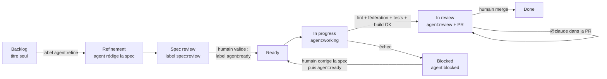

# Workflow agentique : des issues au board, du ticket à la PR

Les issues GitHub servent de specs. Un agent Claude (via
[`anthropics/claude-code-action`](https://github.com/anthropics/claude-code-action))
les transforme en spécifications, les implémente une par une et ouvre une pull
request. **Rien n'est mergé sans validation humaine.**

Même fonctionnement que sur `fanfiction-front-vue`, `fanfiction`, `elearning`
et les dépôts Angular, adapté à **deux apps React fédérées** (`storefront`,
remote ; `adminpanel`, hôte) qui dépendent d'une API séparée et privée
(`merch_store`). `blog/` n'est pas couvert par les agents. Voir la dernière
section pour les différences.

## Cycle de vie d'un ticket

| Étape | Qui | Déclencheur | Ce qui se passe |
| --- | --- | --- | --- |
| Raffinement | Agent | label `agent:refine` (ou lancement manuel sur une liste d'issues / une épic entière) | L'agent lit le ticket, l'épic parente, les tickets voisins, le code des deux apps et celui de l'API, puis remplace le corps de l'issue par une spec (contexte, critères d'acceptation, impact technique — app(s), fédération, endpoints, accessibilité —, plan de test, hors périmètre, questions ouvertes, estimation). Label → `spec:review`. |
| Validation de la spec | **Toi** | — | Tu relis, corriges le corps de l'issue, tranches les questions ouvertes, puis poses `agent:ready`. |
| Implémentation | Agent | label `agent:ready`, lancement manuel, ou toutes les 3 h (prochain ticket `agent:ready`) | Un ticket à la fois. Branche `agent/issue-<n>-<slug>`, implémentation + tests `node:test`, puis vérification dans le navigateur Playwright contre la plateforme qui tourne (API Django de démo, storefront et admin qui charge son remote), en desktop et en mobile, captures jointes à la PR ; puis par le workflow (ESLint sur les lignes modifiées, contrat de fédération, tests et build des deux apps). PR ouverte sur `main` avec `Closes #n`, revue demandée à la propriétaire du dépôt. Label → `agent:review`. Si une vérification échoue : PR **brouillon** + `agent:blocked`. |
| Revue | **Toi** | — | Tu relis la PR. Pour des corrections, commente `@claude …` (commentaire général, de ligne ou de revue) : l'agent pousse sur la même branche. |
| Validation | **Toi** | merge | La PR ferme l'issue → `Done`. Si la PR touche aux modules exposés : déploie le storefront **avant** l'admin. |

Garde-fous :

- Les épics (issues avec sous-tickets) ne sont jamais implémentées directement :
  pose `agent:ready` sur leurs sous-tickets.
- Un ticket `agent:ready` sans section « Critères d'acceptation » repart
  automatiquement en raffinement.
- L'agent ne voit que le ticket, l'épic et les commentaires des mainteneurs
  (le dépôt est public : les commentaires de tiers sont écartés pour éviter
  l'injection de prompt). Il n'a accès ni au réseau ni à `gh` ; il ne peut
  lancer que `scripts/agent/check-changed.mjs`, `test.sh`, `build.sh`,
  `wait-storefront.sh`, `api.sh` (qui n'appelle que l'API locale) et quelques
  commandes git en lecture, et le navigateur ne peut ouvrir que la plateforme
  locale (`localhost:3000`, `localhost:5001` et l'API sur `:8000`). Il ne peut
  pas ajouter de dépendance.
- L'API de l'agent est le dépôt **privé** `delitamakanda/merch_store` (branche
  `main`, ou la variable `AGENT_BACKEND_REF`), cloné avec un jeton dans
  `.agent-out/backend/` (ignoré par git) et lancé par son propre
  `scripts/agent/start-app.sh` : base SQLite jetable, jamais Postgres ni des
  données réelles. Les comptes de démo (`demo-admin`, staff, et
  `demo-customer`, mot de passe `demo-password-123`), 5 produits, 3 catégories,
  le coupon `DEMO10`, la promotion `demo-winter-sale` et une commande sont créés
  par `manage.py seed_demo`. L'agent lit le code de l'API pour connaître les
  endpoints mais ne le modifie pas : un besoin côté backend est signalé dans la
  PR (section « API utilisée ») et fait l'objet d'un ticket sur `merch_store`.
  Le dépôt `microfrontend` étant public, une spec ou une PR peut citer des noms
  d'endpoints ou de champs de ce backend privé.
- Toute modification de `.github/` par l'agent est annulée avant le commit, et
  c'est le workflow, pas l'agent, qui commit, pousse et ouvre la PR.

## Le board

`agent-board.yml` range chaque issue dans une colonne du champ **Status** de
ton GitHub Project selon ses labels :

| Label / état | Colonne (noms acceptés) |
| --- | --- |
| aucun | Backlog / Todo (uniquement si la carte n'a pas encore de statut) |
| `agent:refine` | Refinement |
| `spec:review` | Spec review |
| `agent:ready` | Ready |
| `agent:working` | In progress |
| `agent:review` | In review |
| `agent:blocked` | Blocked |
| fermée | Done |

Un déplacement manuel d'une carte sans label agent n'est jamais écrasé. Si une
colonne n'existe pas, la carte reste où elle est (un avertissement est loggé).
Le premier lancement manuel importe tout le backlog existant dans le board.

## Installation (une fois)

1. **App Claude GitHub** : installe <https://github.com/apps/claude> sur ce
   dépôt (ou lance `/install-github-app` dans Claude Code).
2. **Environnement `claude`** : les secrets et variables ci-dessous vivent dans
   l'environnement GitHub `claude` (_Settings → Environments → claude_), pas au
   niveau du dépôt. Les jobs qui les lisent déclarent `environment: claude`.
   Ajoute-y le secret `CLAUDE_CODE_OAUTH_TOKEN` (abonnement Claude, généré
   avec `claude setup-token`).
3. **Accès au backend privé** : ajoute le secret `AGENT_BACKEND_TOKEN`, un PAT
   _fine-grained_ limité au dépôt `delitamakanda/merch_store` avec la seule
   permission **Contents : Read-only**. À défaut, les workflows utilisent
   `AGENT_PROJECT_TOKEN` (PAT classique `repo`, étape 6), qui suffit mais donne
   plus de droits que nécessaire. Sans aucun des deux, le raffinement se fait
   sans le code de l'API et l'implémentation échoue (`agent:blocked`).
4. **PR créées par Actions** : _Settings → Actions → General → Workflow
   permissions_ → coche **Allow GitHub Actions to create and approve pull
   requests**.
5. **Labels** : `GH_REPO=delitamakanda/microfrontend bash scripts/agent/setup-labels.sh`
6. **Board** :
   - Crée un GitHub Project ou, plus simple, réutilise celui de l'API
     `merch_store` : fronts et back sur le même board ; ajoute au champ
     **Status** les colonnes : `Backlog`, `Refinement`, `Spec review`, `Ready`,
     `In progress`, `In review`, `Blocked`, `Done`.
   - Enregistre un PAT classique (scopes `repo` et `project`) dans le secret
     `AGENT_PROJECT_TOKEN` — le même que pour tes autres dépôts convient.
   - Ajoute la variable `AGENT_PROJECT_NUMBER` (le numéro dans l'URL du projet,
     `…/users/delitamakanda/projects/<n>`). `AGENT_PROJECT_OWNER` est
     facultative (par défaut : le propriétaire du dépôt).
   - Lance _Actions → Agent – board → Run workflow_ (d'abord avec `dry_run`)
     pour importer toutes les issues.
7. **Modèle** (facultatif) : variable `AGENT_MODEL` (`sonnet` par défaut,
   `opus` pour des tickets plus complexes, par exemple ceux qui changent le
   contrat de fédération).
8. **API** (facultatif) : variable `AGENT_BACKEND_REF` pour faire tourner
   l'agent contre une autre branche de `merch_store` que `main` (par exemple la
   branche d'une PR backend dont le ticket front dépend).

## Utilisation au quotidien

- Raffiner une épic entière : _Actions → Agent – raffinement → Run workflow_,
  champ `epic` = numéro de l'épic, ou champ `issues` = liste (ex. `8,9,10`).
- Implémenter un ticket précis tout de suite : _Actions → Agent –
  implémentation → Run workflow_, champ `issue`.
- Débloquer un ticket `agent:blocked` : corrige la spec ou la PR, retire
  `agent:blocked` et repose `agent:ready`.
- Reproduire l'environnement de l'agent en local :
  `bash scripts/agent/install.sh`, puis (backend cloné dans
  `.agent-out/backend` avec ses dépendances Python installées)
  `bash scripts/agent/start-app.sh`.

## Fichiers

| Fichier | Rôle |
| --- | --- |
| `.github/workflows/agent-refine.yml` | Raffinement des tickets en specs |
| `.github/workflows/agent-implement.yml` | Implémentation + PR |
| `.github/workflows/agent-review.yml` | Retours de revue via `@claude` |
| `.github/workflows/agent-board.yml` | Synchronisation du board |
| `.github/workflows/ci.yml` | CI : tests et build de chaque app, contrat de fédération + ESLint des lignes modifiées (lancée aussi manuellement sur les branches de l'agent) |
| `.github/agent/prompts/*.md` | Instructions des agents (à ajuster librement) |
| `.github/agent/mcp.json` | Navigateur Playwright MCP (plateforme locale uniquement) |
| `.github/ISSUE_TEMPLATE/spec.yml` | Formulaire d'issue au format spec |
| `scripts/agent/prepare-issue.mjs` | Contexte du ticket fourni à l'agent |
| `scripts/agent/board-sync.mjs` | Labels → colonnes du GitHub Project |
| `scripts/agent/setup-labels.sh` | Création des labels |
| `scripts/agent/install.sh` | Installation des deux apps (pnpm 8 / pnpm 9) |
| `scripts/agent/start-app.sh` | API de démo sur `:8000` + storefront (build continu + preview) sur `:3000` + admin sur `:5001` |
| `scripts/agent/wait-storefront.sh` | Attend la fin du rebuild du remote après une modification du storefront |
| `scripts/agent/api.sh` | Appels à l'API locale avec les comptes de démo |
| `scripts/agent/check-changed.mjs` | ESLint (bloquant seulement sur les lignes modifiées) + contrat de fédération |
| `scripts/agent/test.sh`, `build.sh` | Tests `node:test` et builds de production des deux apps |
| `.claude/agents/*.md` | Sous-agents : `test-writer`, `ui-reviewer`, `dependency-keeper` |

## Différences avec `fanfiction-front-vue`

- **Deux apps, une fédération.** Le storefront est le remote, l'admin l'hôte
  qui lui emprunte session (`AuthProvider`, `useAuth`) et instance Axios
  (`api`). Avec `@originjs/vite-plugin-federation`, le remote
  `storefrontEntry.js` n'existe qu'après un build : `start-app.sh` lance le
  storefront en `vite build --watch` + `vite preview` (port 3000) et l'admin en
  `vite` dev (port 5001). Après une modification du storefront, l'agent lance
  `wait-storefront.sh` (rebuild de ~3 s) avant de recharger les pages.
- **Contrat de fédération vérifié.** `check-changed.mjs` contrôle que chaque
  import `storefrontApp/<Module>` de l'admin existe dans `exposes` et que le
  fichier exposé exporte bien ce qui est importé ; la PR a une section
  `## Fédération et déploiement` (le storefront de prod est chargé à chaud par
  l'admin de prod : il se déploie en premier).
- **URL de l'API configurable.** `storefront/src/constants.js` lit
  `VITE_API_URL` (au build ; voir `storefront/.env.example`), avec l'API de
  prod par défaut : sans cela l'agent aurait tapé dans la prod.
- **Backend privé** : jeton `AGENT_BACKEND_TOKEN` (ou `AGENT_PROJECT_TOKEN`)
  pour le cloner ; authentification de `api.sh` en Basic.
- **Tests** : `node:test`, sans JSX ni DOM : l'agent teste la logique pure
  (helpers, atomes Jotai). Pas de Vitest ni de Testing Library (pas de nouvelle
  dépendance sans ticket).
- **Lint** : ESLint 8 côté storefront, 9 côté admin, ≈27 et ≈29 erreurs
  préexistantes : seules les lignes modifiées bloquent. Pas de Prettier.
- **pnpm** : une version par app (lockfile v6 → pnpm 8, v9 → pnpm 9).
- Les cartes du dashboard admin (`dailyRevenue`, `dailyOrders`,
  `newCustomers`) sont en erreur sur la base SQLite de l'agent : bug du
  backend, à corriger dans `merch_store`.
- La branche par défaut est `main`.
